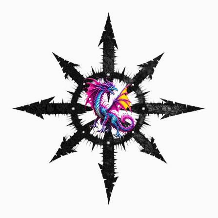

 

#  Chaos Shredder

**Normal words in. Chaos out.**

A text transformer for Android, part of the **Chaos Collection** by Aunt13psychot1c. Type or paste anything, pick a style, and copy or save the chaos. Everything happens on your phone, with no internet, no account and no API key.

## ✂️ Ten ways to shred

| Mode | What it does |
|---|---|
| 🔄 Reverse Text | `hello world` → `dlrow olleh` |
| ↔️ Backwards Words | `hello world` → `world hello` |
| 🔃 Flip Letters | `hello world` → `olleh dlrow` |
| 🙃 Upside-Down Text | reads right when you turn the phone around |
| 🪞 Mirror Text | backwards, like in a mirror |
| 🔁 Mirror Letters | mirrored letters, normal order |
| 🐉 **Jabberwocky** | turns words into real-sounding nonsense, like Lewis Carroll's *"'Twas brillig, and the slithy toves"* 🎲 |
| 👹 Cursed | creepy glitch marks, with a curse-level slider |
| 🧽 Mocking Caps | aLtErNaTiNg CaPs FoR mAxImUm SaSs |
| 🧠 Brain Rot | no cap, fr fr 💀 🎲 |

## 🎨 Your look, your call

The first time it opens it asks: **🩶 Grey** (dreary & drab, very professional) or **🌈 Rainbow Bright** (fun & chaotic). Tap ⚙️ anytime to switch, and pick **Light**, **Dark** or **System**.

## ✨ Extras

- Highlight text in any app and pick **Chaos Shredder** from the menu, or **Share** text to it, and it opens already loaded
- Text Statistics: characters with and without spaces, words, sentences, paragraphs
- Upload a `.txt`, or save your chaos as one

## ⬇️ Install

1. Go to **[Releases](https://github.com/aunt13psychot1c/Chaos-Shredder/releases/latest)** and tap the `.apk`
2. Open it, and allow installing from your browser if Android asks
3. Shred away 🌀

## 🍕 Feed the chaos

Love it? [Buy Aunt13 a pizza](https://buymeacoffee.com/Aunt13psychot1c)

---

© Queen of Chaos · Built for the wonderfully strange 🥀 · MIT license
